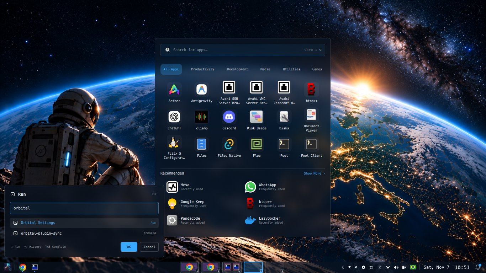

# Orbital

A dark, glassy Omarchy theme inspired by Earth seen from orbit: floating taskbar and dock, centered app drawer, Windows-style Run dialog, calendar, world clock, themed crash handler, and a dynamic color picker that recolors accent and glass tint across the entire desktop.



---

## Features

| Component | Description |
|---|---|
| **Theme Core** | Glass tokens (`colors.toml`, `shell.toml`), blur rules, rounded corners, and terminal/app themes |
| [`orbital.launcher`](plugins/orbital.launcher/) | Centered app drawer with fuzzy search, categories, recommended apps, and app management |
| [`orbital.run`](plugins/orbital.run/) | Windows-style Run dialog (`Super+R`): launch apps, URLs, paths, or CLI commands with live completions and history |
| [`orbital.dock`](plugins/orbital.dock/) | Floating dock bar widget with pinned and active apps |
| [`orbital.floating-bar`](plugins/orbital.floating-bar/) | Floating bar with rounded corners and edge gaps (default bar) |
| [`orbital.bar`](plugins/orbital.bar/) | Integrated alternative bar with dock, workspace pills, and system controls |
| [`orbital.workspaces`](plugins/orbital.workspaces/) | Workspace indicators displaying running application icons |
| [`orbital.clock`](plugins/orbital.clock/) | Clock with calendar popup, reminders, and live weather (`wttr.in`) |
| [`orbital.appearance`](plugins/orbital.appearance/) | Dynamic color picker: recolor accent and glass tints (18 presets or custom hex) via UI or CLI |
| [`orbital.account`](plugins/orbital.account/) | User profile card with quick settings, links, and power actions |
| [`orbital.keyboard`](plugins/orbital.keyboard/) | Tray widget with active layout flag and fast switching (`Alt+Shift` or `Super+Space`) |
| [`orbital.worldclock`](plugins/orbital.worldclock/) | World clock, alarms, and timers |
| [`orbital.crash`](plugins/orbital.crash/) | Themed crash alert with "Diagnose with AI" integration |
| [`orbital.lockscreen`](plugins/orbital.lockscreen/) | Lock screen manager with live visual preview switcher |

---

## Installation

### Quick Install (Recommended)

Run the interactive terminal wizard:

```bash
curl -fsSL https://raw.githubusercontent.com/afmpjr/omarchy-orbital-theme/main/download_cli.sh | bash
```

### Manual Install

```bash
omarchy theme install https://github.com/afmpjr/omarchy-orbital-theme
cd ~/.config/omarchy/themes/orbital && ./install.sh
omarchy theme set orbital
```

### Installer Options

| Flag | Description |
|---|---|
| `--full` | Full desktop profile (bar layout, dock pins, Super+S launcher, Alt+Shift layout toggle, 4-finger swipe) |
| `--windows-keys` | Enables Windows-style keybindings (`Super+R` Run, `Super+V` clipboard, `Ctrl+Alt+Del` btop, etc.) |
| `--bar-widgets` | Installs widgets into your existing bar without changing the bar design |
| `--keep-bar` | Keeps your current bar instead of switching to `orbital.floating-bar` |
| `--keyboard-layouts br,us` | Sets keyboard layouts for the tray widget and toggle |
| `--dry-run` | Previews changes without touching any files |
| `--uninstall` | Reverts all theme changes and restores original configurations |

---

## Key Shortcuts (Windows-Like Mode)

When configured with `--windows-keys`, Orbital provides intuitive Windows-familiar shortcuts:

| Shortcut | Action |
|---|---|
| <kbd>Super</kbd> + <kbd>S</kbd> | Open App Drawer (`orbital.launcher`) |
| <kbd>Super</kbd> + <kbd>R</kbd> | Open Run dialog (`orbital.run`) |
| <kbd>Super</kbd> + <kbd>V</kbd> | Clipboard history |
| <kbd>Super</kbd> + <kbd>Shift</kbd> + <kbd>S</kbd> | Region screenshot (Snipping) |
| <kbd>Ctrl</kbd> + <kbd>Alt</kbd> + <kbd>Del</kbd> | Task Manager (`btop` in floating terminal) |
| <kbd>Ctrl</kbd> + <kbd>Shift</kbd> + <kbd>Esc</kbd> | Task Manager (`btop`) |
| <kbd>Super</kbd> + <kbd>Space</kbd> / <kbd>Alt</kbd> + <kbd>Shift</kbd> | Switch keyboard layout |
| <kbd>F11</kbd> / <kbd>Super</kbd> + <kbd>F</kbd> | Toggle Fullscreen |
| <kbd>Alt</kbd> + <kbd>F4</kbd> / <kbd>Super</kbd> + <kbd>W</kbd> | Close active window |
| <kbd>Super</kbd> + <kbd>E</kbd> | Open File Manager |
| <kbd>Super</kbd> + <kbd>L</kbd> | Lock screen |
| <kbd>Super</kbd> + <kbd>D</kbd> / <kbd>Super</kbd> + <kbd>Ctrl</kbd> + <kbd>D</kbd> | Minimize all windows / New empty workspace |

---

## Customization

### Accent & Glass Tint Color Picker
- **GUI:** Click your avatar in the dock &rarr; select **Appearance**.
- **CLI:**
  ```bash
  python3 ~/.config/omarchy/plugins/orbital.appearance/orbital-accent.py <preset|#hex|list|current>
  ```

### Profile Avatar
Set your profile picture in the dock, account card, and lock screen:
```bash
~/.config/omarchy/plugins/orbital.account/orbital-avatar ~/Pictures/me.jpg   # Local image
~/.config/omarchy/plugins/orbital.account/orbital-avatar --github            # Pull from GitHub profile
~/.config/omarchy/plugins/orbital.account/orbital-avatar --reset             # Reset to Omarchy icon
```

---

## Update & Maintenance

### Update to Latest Version
```bash
omarchy theme update
cd ~/.config/omarchy/themes/orbital && ./install.sh
```

### Verification
```bash
omarchy plugin list | grep orbital   # Check installed and enabled plugins
hyprctl configerrors                 # Verify Hyprland configuration integrity
```

---

## Requirements

- **Omarchy** &ge; 4.0 (with Quickshell plugin system)
- **Hyprland** with Lua configuration support
- **Core tools:** `python3`, `jq`, `curl`
- Optional: `systemd-coredump` (for AI crash diagnostics), `wttr.in` network access (for weather)

---

## License

Distributed under the [MIT License](LICENSE). Third-party acknowledgments in [docs/NOTICE.md](docs/NOTICE.md) and asset credits in [CREDITS.md](CREDITS.md).
